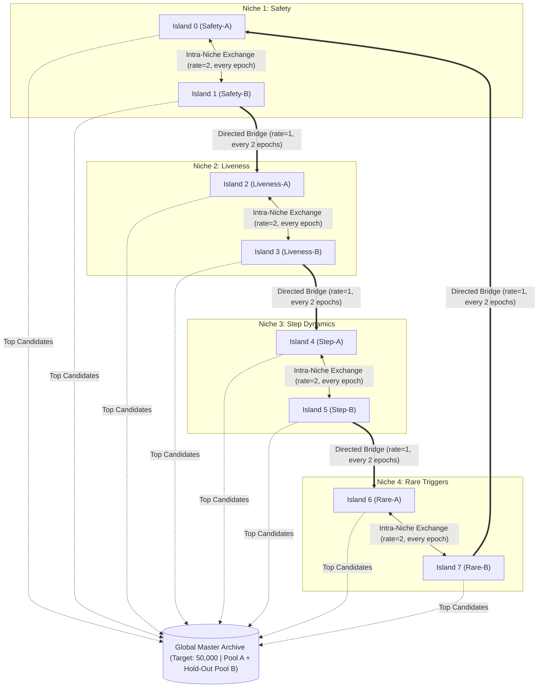

# Evolutionary Optimization for Semantic Orthogonality in LTLf Dataset Synthesis

**Course:** Optimization for AI — Master's Degree in Foundations of Artificial Intelligence  
**Institution:** University of Trieste (UniTS)  
**Author:** Nicola Gigante  
**Context:** Research project developed in synergy with the *LTLfBERT* Bachelor's Thesis  

---

## Abstract

In this project, I address the fundamental optimization problem of generating large-scale, semantically diverse, and mutually orthogonal datasets of Linear Temporal Logic over finite traces (LTLf). While LTLfBERT—the subject of my Bachelor's thesis—aims to learn joint semantic representations of temporal formulas and system execution traces through contrastive neural architectures, its training dynamics are fundamentally constrained by dataset quality. In particular, standard random formula generators (such as Spot's `randltl`) suffer from severe semantic clustering and high redundancy (~29% duplicate semantic signatures), which systematically introduces false negatives into contrastive batches and causes representation collapse.

To solve this, as my project for the Master's course **Optimization for AI**, I formulate dataset generation as an explicit combinatorial optimization problem over formal grammar trees. In this report, I document my journey across two evolutionary paradigms:
1. **Phase 1 (Single-Population GP - `gp_ltlf.py`)**: An archive-based Genetic Programming framework driven by a composite scalarized fitness function penalizing archive similarity, satisfaction skewness, and tree bloat. While effective at small scales (1,000 formulas with 100% unique signatures), this approach hit a severe *scaling wall* at ~16,000 formulas due to genetic diversity collapse, single-threaded archive bottlenecks, and multi-objective whitening.
2. **Phase 2 (Coarse-Grained Island Model - `gp_island.py`)**: A parallel evolutionary architecture distributing 8 independent sub-populations across 8 CPU processes on the Demetra HPC cluster. To resolve multi-objective whitening without weight collapse, I designed 4 specialized functional niches (Safety, Liveness, Step Dynamics, Rare Triggers) connected through a bipartite ring migration topology with asymmetric bridges to prevent inter-island dominance. To scale orthogonality checks to 50,000 formulas without evolutionary overfitting, I engineered a zero-copy POSIX `SharedMemory` `float32` BLAS archive alongside a **Dual-Pool Semantic Evaluation** protocol (1,024-trace evolution pool decoupled from a 2,048-trace hold-out validation pool).

On Demetra HPC (Slurm Job `132790`), this Island Model evolved the target **50,000 mutually orthogonal formulas** in 1,086 epochs (**200,000 verified examples** across `train`/`val`/`test`/`ood`), reducing nearest-neighbor similarity from 85.4% (`randltl`) to **19.2%**, completely eliminating redundant semantic signatures, discovering complex temporal properties (mean AST depth 12.76 vs. 5.37), and guaranteeing zero formula leakage across dataset splits.

---

## 1. Introduction and Motivation

### 1.1 Context: LTLfBERT and Conformance Checking as Representation Learning

Linear Temporal Logic over finite traces (LTLf) is the de-facto standard specification language for expressing properties of reactive, discrete-event, and business process systems over finite time horizons. In formal verification, the fundamental task is **conformance checking**: given an LTLf formula $\phi$ and a sequence of propositional states $\sigma = \langle s_0, s_1, \dots, s_{L-1} \rangle$, determine whether the trace satisfies the formula ($\sigma \models \phi$).

In my Bachelor's thesis, I developed **LTLfBERT**, a siamese dual-encoder Transformer architecture based on CodeBERT that learns distributed vector representations $z^\phi = f_\theta(\phi)$ and $z^\sigma = g_\psi(\sigma)$ aligned in a joint latent space. The model is pre-trained via the symmetric **NT-Xent** (Normalized Temperature-scaled Cross-Entropy) contrastive loss over mini-batches of $N$ valid pairs $\{(\phi_i, \sigma_i)\}_{i=1}^N$ where $\sigma_i \models \phi_i$:

$$\mathcal{L}_{\text{NT-Xent}} = -\frac{1}{2N} \sum_{i=1}^{N} \left[ \log \frac{\exp(\text{sim}(z^\phi_i, z^\sigma_i) / \tau)}{\sum_{j=1}^{N} \exp(\text{sim}(z^\phi_i, z^\sigma_j) / \tau)} + \log \frac{\exp(\text{sim}(z^\sigma_i, z^\phi_i) / \tau)}{\sum_{j=1}^{N} \exp(\text{sim}(z^\sigma_i, z^\phi_j) / \tau)} \right]$$

where $\text{sim}(u, v) = \frac{u^\top v}{\|u\| \|v\|}$ is the cosine similarity and $\tau$ is a temperature hyperparameter.

### 1.2 The Failure Mode of Naive Random Generation (`randltl`)

Contrastive self-supervised learning rests on a fundamental statistical assumption: **in-batch negative pairing**. In the NT-Xent objective above, any sample $j \ne i$ in the mini-batch is assumed to be a true negative: that is, the trace $\sigma_j$ is assumed *not* to satisfy formula $\phi_i$, and trace $\sigma_i$ is assumed *not* to satisfy formula $\phi_j$.

When training datasets are generated using standard tools such as Spot's `randltl` (which samples syntax trees uniformly at random from a context-free grammar), this assumption breaks down catastrophically:
1. **Severe Semantic Degeneracy**: Random tree generation over temporal operators ( $\mathbf{X}$, $\mathbf{F}$, $\mathbf{G}$, $\mathbf{U}$) exhibits an extreme bias toward semantic trivialities. Operators such as $\mathbf{F}\mathbf{F}p$ collapse into $\mathbf{F}p$, negations readily form tautological or contradictory subtrees, and deep expressions frequently evaluate to constant truth values on finite traces.
2. **Dense Semantic Clustering**: Random sampling repeatedly rediscovers the exact same semantic behaviors under different syntactic surfaces (e.g., $p_0 \land \mathbf{X} p_1$ vs. $\mathbf{X} p_1 \land p_0$). As empirical benchmarks reveal, **nearly 29% of all formulas generated by `randltl` share identical truth signatures across evaluation traces**.
3. **The False Negative Catastrophe in Contrastive Loss**: When two formulas in a batch $\phi_i$ and $\phi_j$ are semantically equivalent or highly overlapping, a trace $\sigma_i$ satisfying $\phi_i$ will also satisfy $\phi_j$. Yet, the NT-Xent denominator explicitly forces $z^\sigma_i$ away from $z^\phi_j$. The network is actively penalized with large gradient updates for recognizing that $\sigma_i$ satisfies $\phi_j$. This introduces pervasive gradient noise, prevents semantic alignment, and causes latent representation collapse.

### 1.3 The Formulation as an Optimization Problem

To provide high-quality data for LTLfBERT, formula generation cannot be left to uninformed random sampling. In the context of the Master's course **Optimization for AI**, I formulated this challenge as an explicit **combinatorial and multi-objective optimization problem**:

Given an alphabet of atomic propositions $\mathcal{P} = \{p_0, p_1, p_2, p_3\}$ and temporal/Boolean operators $\mathcal{O} = \{\neg, \land, \lor, \to, \mathbf{X}, \mathbf{F}, \mathbf{G}, \mathbf{U}\}$, search the combinatorial tree space $\mathcal{T}$ to evolve a set of $N$ formulas $\Phi^* = \{\phi_1, \dots, \phi_N\}$ that maximizes:
1. **Mutual Semantic Orthogonality**: minimize pairwise statistical dependence ( $|\phi|$ correlation) over a universe of finite execution traces.
2. **Satisfaction Balance**: ensure every formula is non-trivial ( $r_{\text{lo}} \le \mathbb{P}_{\sigma}[\sigma \models \phi] \le r_{\text{hi}}$) so both positive and negative witnesses exist.
3. **Syntactic Parsimony**: minimize tree bloat and computational complexity.

---

## 2. Dataset Comparison Framework and Evaluation Metrics

To rigorously assess whether an optimization algorithm produces superior datasets compared to baseline random sampling, I designed a multi-dimensional benchmarking suite ([`src/gp/compare_datasets.py`](file:///home/gugutca/PycharmProjects/LTLfBERT/src/gp/compare_datasets.py)).

### 2.1 The Semantic Signature Protocol

Standard NLP evaluation metrics (such as Levenshtein distance, token overlap, or BLEU) are meaningless for formal logic: two syntactically distant formulas like $\neg (p \land q)$ and $\neg p \lor \neg q$ have identical semantics, whereas flipping a single operator ( $p \land q$ vs. $p \lor q$) alters truth conditions drastically.

To measure semantic identity without falling into the exponential cost of Büchi automaton equivalence checks (which hang on formulas of height $>6$), I established the **Semantic Signature Protocol**:
- An independent held-out evaluation pool of $T = 1024$ finite traces $\mathcal{V} = \{\sigma_1, \sigma_2, \dots, \sigma_T\}$ is sampled (`seed=12345`) with lengths uniformly distributed in $L \in [3, 100]$.
- For any formula $\phi$, its **semantic signature** $S(\phi) \in \{0, 1\}^T$ is the binary vector representing its truth value over the evaluation trace pool:
  $$S(\phi)_t = \begin{cases} 1 & \text{if } \sigma_t \models \phi \\ 0 & \text{if } \sigma_t \not\models \phi \end{cases}$$
- Signatures are computed using a vectorized, bottom-up NumPy interpreter (`sem()` in [`src/gp/gp_ltlf.py`](file:///home/gugutca/PycharmProjects/LTLfBERT/src/gp/gp_ltlf.py)), evaluating 2,000 sampled formulas across 1,024 traces without automaton construction bottlenecks.

### 2.2 Formal Definitions of Evaluation Metrics

To avoid penalizing dense or sparse formulas asymmetrically (as Jaccard similarity does), semantic similarity between two formulas $\phi_a$ and $\phi_b$ is measured via **absolute phi correlation** ($|\phi|$) over their binary signatures:

$$\text{sim}(\phi_a, \phi_b) = \left| \frac{T \sum_{t=1}^T S_a[t] S_b[t] - \left(\sum_{t=1}^T S_a[t]\right)\left(\sum_{t=1}^T S_b[t]\right)}{\sqrt{n_a (T - n_a)\, n_b (T - n_b)}} \right| \in [0, 1]$$

where $n_a = \sum_t S_a[t]$ and $n_b = \sum_t S_b[t]$. Equivalently, on mean-centered, $L_2$-normalized signatures $\tilde{S} = (S - \bar{S}) / \|S - \bar{S}\|_2$, this equals $|\tilde{S}_a^\top \tilde{S}_b|$; constant/degenerate vectors ($n \in \{0, T\}$) or exact complements ($S_a = \neg S_b$) are assigned $\text{sim} = 1.0$. Thus $|\phi| = 0$ denotes statistical independence (orthogonality), while $|\phi| = 1$ denotes empirical equivalence or exact logical negation.

| Metric | Mathematical Formulation | Optimization Objective / Purpose |
| :--- | :--- | :--- |
| **Unique Signatures** | $\{S(\phi) : \phi \in \Phi_{\text{sample}}\}$ | **Maximize**: Measures effective semantic diversity. If 2,000 formulas produce 1,421 signatures, ~29% are redundant duplicates. |
| **Pairwise Similarity** | $\text{sim}(\phi_a, \phi_b) = \phi(S(\phi_a), S(\phi_b))$ | **Minimize**: Semantic dependence between pairs. We track $\text{mean}$, 95th percentile ( $\text{p95}$), and maximum ( $\text{max}$). |
| **Frac. Pairs $\text{sim} > 0.9$** | $\frac{1}{\binom{M}{2}} \sum_{a < b} \mathbb{I}(\text{sim}(\phi_a, \phi_b) > 0.9)$ | **Minimize (Target: 0.0)**: Fraction of near-identical or negated pairs in the dataset. |
| **Nearest-Neighbor Sim.** | $\text{nn\_sim}(\phi) = \max_{\psi \in \Phi \setminus \{\phi\}} \text{sim}(\phi, \psi)$ | **Minimize**: Quantifies clustering. High average NN similarity means formulas form tight, redundant clusters in semantic space. |
| **Satisfaction Balance** | $\mu_{\text{sat}} = \mathbb{E}[\text{mean}(S(\phi))], \quad \sigma_{\text{sat}}$ | **Target $\mu \approx 0.50$, moderate $\sigma$**: Ensures formulas are balanced and non-trivial (neither tautologies $\mu=1$ nor contradictions $\mu=0$). |
| **Cross Equivalence** | $\frac{1}{\Phi_B} \sum_{\phi \in \Phi_B} \mathbb{I}(\max_{\psi \in \Phi_A} \text{sim}(\phi, \psi) > 0.95)$ | **Minimize**: Fraction of evolved formulas that already existed in the baseline dataset. Measures true novelty. |
| **Operator Entropy** | $H(\mathcal{O}) = -\sum_{op} p(op) \log_2 p(op)$ | **Balance**: Ensures structural variety across temporal and propositional connectives. |
| **Formula Leakage** | $\sum_{s_1 \ne s_2} \Phi_{s_1} \cap \Phi_{s_2}$ | **Strictly 0**: Verifies that no formula appears across multiple splits (zero data leakage). |

---

## 3. Phase 1: Archive-Based Single-Population Genetic Programming (`gp_ltlf.py`)

### 3.1 Genetic Encoding and Tree Grammar

In the initial phase of the project, I implemented an archive-based Evolutionary Algorithm using the Python DEAP (Distributed Evolutionary Algorithms in Python) framework.

Each individual is represented as a **Primitive Tree** generated over the grammar:
- **Terminal Set**: $\mathcal{T} = \{p_0, p_1, p_2, p_3\}$
- **Primitive Set**: Unary operators $\{\text{NOT}, \mathbf{X}, \mathbf{F}, \mathbf{G}\}$ (arity 1) and binary operators $\{\text{AND}, \text{OR}, \text{IMPL}, \mathbf{U}\}$ (arity 2). Note that $\mathbf{X}$ encodes strong next (`X[!]`) under finite-trace semantics.
- **Initialization**: Ramped Half-and-Half method (`gp.genHalfAndHalf`, min depth 1, max depth 4) to ensure a balanced variety of deep and bushy expression trees.
- **Genetic Operators**:
  - *Crossover*: Subtree exchange via one-point crossover (`gp.cxOnePoint`) with probability $p_c = 0.7$.
  - *Mutation*: Uniform subtree mutation (`gp.mutUniform`) generating random subtrees of depth $0 \le d \le 2$ with probability $p_m = 0.3$.
  - *Bloat Control*: Static tree height limit $H_{\max} = 7$ enforced via `gp.staticLimit`.
  - *Elitism*: The top 5 fittest individuals strictly survive across generational transitions.

```text
       [U]  <-- Binary Temporal Operator (Until)
      /   \
    [G]   [AND]
     |    /   \
   [p0] [X]   [p2]
         |
       [p1]
Syntax: (G(p0) U (X[!](p1) & p2))
```

### 3.2 The Multi-Objective Composite Fitness Function

The core mechanism of `gp_ltlf.py` lies in its **Archive-Driven Fitness Function**. To evolve a set of mutually orthogonal formulas without computing the full $O(N^2)$ pairwise distance matrix at every generation, I maintained an incremental **Archive** $\mathcal{A} = \{S(\psi_1), \dots, S(\psi_k)\}$ of all individuals previously accepted into the dataset.

For a candidate individual $\text{ind}$ with signature $S(\text{ind}) \in \{0, 1\}^T$:

1. **Orthogonality Term**:
   I measure the worst-case absolute phi correlation against all already-accepted formulas in the archive:
   $$\text{sim}(S(\text{ind}), \mathcal{A}) = \max_{A \in \mathcal{A}} |\phi(S(\text{ind}), A)|$$
   If the archive is empty, $\text{sim} = 0$.

2. **Satisfaction Skewness Penalty**:
   To prevent the genetic search from cheating by generating tautologies ($S \equiv \mathbf{1}$) or contradictions ($S \equiv \mathbf{0}$), I implemented an asymmetric piecewise linear penalty based on the satisfaction rate $r = \frac{1}{T} \sum_{t=1}^T S(\text{ind})_t$:
   $$\text{pen}_{\text{sat}}(r) = \begin{cases} 3.0 \cdot (r_{\text{lo}} - r) & \text{if } r < r_{\text{lo}} \\ 3.0 \cdot (r - r_{\text{hi}}) & \text{if } r > r_{\text{hi}} \\ 0 & \text{if } r_{\text{lo}} \le r \le r_{\text{hi}} \end{cases}$$
   where $r_{\text{lo}} = 0.15$ and $r_{\text{hi}} = 0.85$.

3. **Parsimony Pressure**:
   To discourage syntactic bloat (unnecessary double negations and neutral identity operations), I added a linear size penalty:
   $$\text{pen}_{\text{size}}(\text{ind}) = \lambda \cdot |\text{ind}|, \quad \lambda = 0.003$$

4. **Total Fitness**:
   The objective maximized by DEAP is:
   $$f(\text{ind}) = - \text{sim}(S(\text{ind}), \mathcal{A}) - \text{pen}_{\text{sat}}(r) - \text{pen}_{\text{size}}(\text{ind})$$

### 3.3 Epoch-Round Dynamic Admission

Evolution proceeds in sequential **Rounds**. In each round:
1. A fresh population of 200 individuals is initialized and evolved for $G = 15$ generations.
2. At generation 15, the top candidates from the population are filtered.
3. Candidate individuals are admitted into $\mathcal{A}$ if and only if $r \in [0.15, 0.85]$ and:
   $$\text{sim}(S(\text{cand}), \mathcal{A}) \le \theta_{\text{sim}} \quad (\theta_{\text{sim}} = 0.60)$$
4. Once admitted, the archive grows, and the fitness landscape for the next round shifts dynamically, compelling subsequent generations to explore uncharted regions of the Boolean hypercube $\{0, 1\}^T$.

### 3.4 Results of the Initial 1,000-Formula Run

I conducted the first validation benchmark by evolving $N = 1,000$ orthogonal formulas with `gp_ltlf.py` and comparing them against the baseline dataset generated by Spot (`data/dataset/`, 756 unique formulas). The quantitative comparison ([`src/gp/report.json`](file:///home/gugutca/PycharmProjects/LTLfBERT/src/gp/report.json)) demonstrated immediate improvements:

| Metric | Dataset A (Spot `randltl`) | Dataset B (Initial `gp_ltlf.py`) | Advantage of GP |
| :--- | :---: | :---: | :--- |
| **Unique Formulas** | 756 | **1,000** | Target reached |
| **Unique Semantic Signatures** | 579 / 756 (**76.6%**) | **1,000 / 1,000 (100.0%)** | **Zero semantic redundancy** |
| **Duplicate Signatures** | 177 (**23.4%**) | **0 (0.0%)** | Completely eliminated |
| **Mean Pairwise Similarity** | 0.0925 | **0.0569** | 38.5% lower mutual overlap |
| **Max Pairwise Similarity** | **1.0000** (exact clones) | **0.6788** | Strong compliance vs. $\theta \le 0.6$ |
| **Fraction Pairs $\text{sim} > 0.9$** | 0.0065 | **0.0000** | Zero near-duplicate pairs |
| **Nearest-Neighbor Similarity** | **0.8246** | **0.4320** | Cluster dispersion doubled |
| **Cross-Equivalence ($B \in A$)** | - | **2.0%** | 98% completely novel logic |

```text
Nearest Neighbor Similarity Distribution (lower is better dispersed):
RandLTL  [==================================================] 82.5% (High clustering)
GP_1k    [==========================] 43.2% (Moderate dispersion)
```

### 3.5 Inspection of Evolved Genetic Trees

Using the tree visualizer ([`src/gp/print_trees.py`](file:///home/gugutca/PycharmProjects/LTLfBERT/src/gp/print_trees.py)), I examined the syntax trees evolved by `gp_ltlf.py`. The algorithm discovered rich, composite temporal structures that naive random sampling rarely generates:

#### Example 1: Evolved Nested Sequential Response
**Formula:** `X[!](X[!](X[!]((G(X[!](p1)) U (p0 & p2)))))`  
**Size:** 10 nodes | **Depth:** 7
```text
X
└── X
    └── X
        └── U
            ├── G
            │   └── X
            │       └── p1
            └── AND
                ├── p0
                └── p2
```
*Semantic Interpretation:* Enforces a delayed progression condition: after three consecutive steps, a persistent periodic obligation on $p_1$ must hold until a simultaneous trigger $(p_0 \land p_2)$ occurs.

#### Example 2: Evolved Invariant Safety with Conditional Implication
**Formula:** `G((p3 | ((X[!](p1) & (p1 | p3)) | (p1 -> p2))))`  
**Size:** 13 nodes | **Depth:** 6
```text
G
└── OR
    ├── p3
    └── OR
        ├── AND
        │   ├── X
        │   │   └── p1
        │   └── OR
        │       ├── p1
        │       └── p3
        └── IMPL
            ├── p1
            └── p2
```
*Semantic Interpretation:* A globally guarded property providing three disjunctive safety fallbacks, tying discrete state implications ( $p_1 \to p_2$) with next-step guarantees.

---

## 4. The Scaling Wall: Bottlenecks of Single-Population Evolution

Encouraged by the 1,000-formula success, I set out to generate the full target dataset required for industrial-scale LTLfBERT pre-training: **50,000 mutually orthogonal formulas** over trace horizons of up to **100 timesteps**.

However, when launching `gp_ltlf.py` at scale, the single-population algorithm hit an impenetrable **scaling wall at approximately 16,000–17,000 formulas**, after which generation ground to a halt.

### 4.1 Theoretical and Algorithmic Root Causes

Through profiling and evolutionary dynamics analysis, I identified four compounding bottlenecks:

#### 1. Genetic Diversity Collapse (Inbreeding & Homogenization)
In a single population subjected to tournament selection ( $k=3$) and elitism, individuals rapidly converge toward the same high-performing structural templates. Once the archive contained ~16,000 signatures, the remaining unoccupied regions of the Boolean hypercube became narrow, disjoint corridors. Crossover between two homogenized individuals almost invariably generated offspring falling into already-occupied regions of the archive, resulting in rejection rates $>99.8\%$.

#### 2. The "Multi-Objective Whitening" Problem
The scalarized fitness function:
$$f(\text{ind}) = - \text{sim}(S(\text{ind}), \mathcal{A}) - \text{pen}_{\text{sat}} - \lambda \cdot |\text{ind}|$$
suffered from severe **objective whitening** (dominance collapse). When the archive grew large, the similarity penalty $-\text{sim}(S, \mathcal{A})$ became uniformly high for almost all valid formulas. Consequently, selection pressure became dominated by secondary terms: the algorithm sought trivial local minima (tiny formulas or extreme satisfaction bounds), washing out the nuanced gradient needed to discover novel temporal operators.

#### 3. Single-Threaded Archive Search Bottleneck
In `gp_ltlf.py`, evaluating a single candidate individual against an archive of $K = 17,000$ formulas required scanning boolean arrays of length $T$:
$$O(K \cdot T) = 17{,}000 \times 1{,}024 \approx 1.74 \times 10^7 \text{ boolean operations per individual}$$
Reallocating the archive via `np.vstack` on every insertion and scanning it on a single thread caused epoch wall-clock times to climb sharply with archive size.

#### 4. Unbounded Memory Growth and Sampling Latency
Without tight cache bounds and vectorized sampling, storing string memoization tables across deep trees and invoking Spot's C++ Büchi product sampler for witness extraction created severe memory pressure and multi-hour post-processing overheads on HPC nodes.

---

## 5. Phase 2: Semantic Speciation via Coarse-Grained Island Model (`gp_island.py`)

To overcome the scaling wall, I redesigned the evolutionary architecture from the ground up, implementing a **Coarse-Grained Parallel Island Model** with **Semantic Speciation**, **Dual-Pool Validation**, and a **Zero-Copy `SharedMemory` `float32` BLAS Archive** ([`src/gp/gp_island.py`](file:///home/gugutca/PycharmProjects/LTLfBERT/src/gp/gp_island.py)).

### 5.1 Architecture: 8 Islands on 8 CPU Cores

Instead of maintaining a single massive population, the Island Model instantiates **8 independent sub-populations (islands)**, each pinned to a dedicated CPU worker process via `concurrent.futures.ProcessPoolExecutor`. Each island maintains a lean population of $M = 60$ individuals evolving concurrently for $G = 10$ generations per epoch ( $p_c = 0.7$, $p_m = 0.3$, tournament size $k=3$, local elitism of the top 3 individuals, and height limit $H_{\max} = 7$):

```text
Total Parallel Population: 8 islands × 60 individuals = 480 active individuals per epoch
```

At the end of each epoch, each island returns its top 15 unique, non-trivial candidates ( $0.05 \le r \le 0.95$) to the Master coordinator, sorted by AST size to favor compact specifications.

### 5.2 Resolving Multi-Objective Whitening via Semantic Niches

To solve the multi-objective whitening problem without fragile scalarization tuning, I introduced **Speciation by Functional Niches**. Rather than forcing all islands to optimize the same generic objective, I partitioned the 8 islands into **4 distinct semantic niches** (2 twin islands per niche):

| Island IDs | Niche Name | Target Behavior | Satisfiability Range $[r_{\text{lo}}, r_{\text{hi}}]$ | Favored Operators ($\mathcal{F}_k$) | Fitness Bonus |
| :---: | :---: | :--- | :---: | :---: | :---: |
| **0, 1** | **Safety** | Invariants, persistent guards, stability | $[0.25, 0.85]$ | $\{\mathbf{G}, \to, \land\}$ | $+0.04$ per distinct op |
| **2, 3** | **Liveness** | Eventualities, progress, until-chains | $[0.20, 0.80]$ | $\{\mathbf{F}, \mathbf{U}, \lor\}$ | $+0.04$ per distinct op |
| **4, 5** | **Step Dynamics** | Sequential steps, state transitions | $[0.20, 0.80]$ | $\{\mathbf{X}, \to, \land\}$ | $+0.04$ per distinct op |
| **6, 7** | **Rare Triggers** | Narrow invariants, exceptional events | $[0.10, 0.35]$ | $\{\land, \neg, \lor\}$ | $+0.04$ per distinct op |

Each island $k$ evaluates individuals using its **Specialized Local Fitness** (with niche penalty weight $3.5$ and parsimony $\lambda = 0.003$):

$$f_k(\text{ind}) = -\text{sim}_A(S_A(\text{ind}), \mathcal{A}_A) - 3.5 \cdot \left(\max(0, r_{\text{lo},k} - r) + \max(0, r - r_{\text{hi},k})\right) + \sum_{\text{op} \in \mathcal{F}_k} 0.04 \cdot \mathbb{I}(\text{op} \in \text{ind}) - \lambda \cdot |\text{ind}|$$

By diversifying the fitness landscape across niches:
- Safety islands explore regions satisfied by persistent states.
- Liveness islands explore guarantees requiring eventual event occurrences.
- Step Dynamics islands specialize in sequential state transitions.
- Rare Trigger islands discover highly selective properties near the lower satisfiability boundary.
- **The Global Master Archive** serves as the unifying front: whenever any island discovers a formula passing both the Evolution Pool and the Hold-Out Validation Pool ( $\max |\phi| \le 0.60$), it is admitted regardless of which niche produced it.

### 5.3 Topology: Bipartite Migration and Dominance Prevention

A critical risk in Island Models is **inter-island dominance**: if an aggressive island discovers a moderately fit formula, indiscriminate migration can flood neighboring islands, wiping out their local genetic diversity and reverting the system to a single homogenized population.

To prevent dominance, I engineered a **Two-Tier Bipartite Ring Migration Topology**:



#### How Dominance is Structurally Eliminated:
1. **Intra-Niche Twin Exchange (Every Epoch)**:
   Twin islands in the same niche ( $0 \leftrightarrow 1$, $2 \leftrightarrow 3$, $4 \leftrightarrow 5$, $6 \leftrightarrow 7$) exchange their top $r_{\text{intra}} = 2$ elite individuals, replacing the bottom 2 worst individuals in the twin. Because both islands share the same niche fitness, this refines specialized traits without disruptive drift.
2. **Asymmetric Inter-Niche Ring Bridges (Every 2 Epochs)**:
   To cross-pollinate building blocks (e.g., combining a Safety $\mathbf{G}$ pattern from Niche 1 with a Liveness $\mathbf{F}$ pattern from Niche 2 to create a Response pattern $\mathbf{G}(p \to \mathbf{F} q)$), individuals migrate along a directed ring:
   $$1 \longrightarrow 2 \longrightarrow 3 \longrightarrow 4 \longrightarrow 5 \longrightarrow 6 \longrightarrow 7 \longrightarrow 0$$
   Only **1 immigrant** ( $r_{\text{inter}} = 1$) is transferred, representing just $1.67\%$ of the recipient's population.
3. **Symmetry Breaking**: Within each niche, Twin B acts as the bridge sender, while Twin A receives incoming immigrants. This breaks circular resonance loops and prevents reciprocal dominance.

### 5.4 Dual-Pool Semantic Evaluation (1,024 + 2,048 Traces)

Scaling archive-driven GP to 50,000 orthogonal formulas introduces a subtle statistical failure mode that does not manifest at $N = 1,000$: **evolutionary overfitting to the evaluation trace pool**. To prevent this without incurring intractable verification costs, I decoupled evolutionary fitness evaluation from archive admission through a **Dual-Pool Semantic Evaluation** protocol.

#### Pool Roles and Information Isolation
1. **Evolution Pool (Pool A, $T_A = 1024$ traces)**:
   Generated from the base seed (`seed=42`, trace lengths $L \in [3, 100]$) and shared read-only with all 8 islands. During local evolution, each island evaluates candidate individuals using the vectorized semantic interpreter `sem()` over Pool A to compute semantic signatures and approximates orthogonality via maximum absolute phi correlation ( $|\phi|$) against the global archive, completely avoiding exponential DFA/Büchi state-space explosion.
2. **Hold-Out Validation Pool (Pool B, $T_B = 2048$ independent traces)**:
   Generated from an independent seed (`seed + 99999`, $L \in [3, 100]$) and retained **exclusively inside the Master coordinator** during the harvesting phase. The 8 worker islands never observe Pool B. Any candidate formula surviving Pool A ( $\max |\phi_A| \le \text{sim_thr} = 0.60$) is admitted to the global archive if and only if it is non-constant on Pool B and also satisfies:
   $$\max_{\psi \in \mathcal{A}_B} |\phi_B(S_B(\text{cand}), S_B(\psi))| \le \text{sim_thr} \quad (0.60)$$

#### Error Behavior: With vs. Without the 2,048-Trace Hold-Out Check
- **Without Pool B (Single Fixed Pool)**:
  For a single random pair of independent formulas on $T_A = 1024$ traces, the nominal standard error of the empirical phi correlation is:
  $$\text{SE}_A \approx \frac{1}{\sqrt{T_A}} = \frac{1}{\sqrt{1024}} \approx 0.03125 \quad (\approx 3.1\%)$$
  However, across thousands of evolutionary generations, GP evaluates millions of candidate syntax trees against the *same* fixed 1,024 traces. As the archive scales toward 50,000 formulas ( $> \binom{50{,}000}{2} \approx 1.25 \times 10^9$ pairwise comparisons), this repeated querying induces **GP selection bias (overfitting)**: evolution systematically discovers and exploits favorable finite-sample fluctuations in Pool A where $|\hat{\phi}_A| \le 0.60$ even though the true population correlation $|\phi_{\text{true}}| > 0.60$. This failure mode is further amplified in low-satisfaction niches (such as `Rare Triggers`, $r \in [0.10, 0.35]$), where fewer positive trace witnesses increase variance in the denominator of $|\phi|$.
- **With Pool B (Hold-Out Validation)**:
  Decoupling evolutionary search (Pool A) from archive admission (Pool B) neutralizes GP selection bias. Exact logical duplicates and exact negations ( $|\phi| = 1$) are already guaranteed to be rejected deterministically on any pool containing discriminating witnesses; for all non-equivalent pairs, evaluating on the unseen Pool B reverts the admission error from biased extreme-value selection back to pure, unbiased sampling variance:
  $$\text{SE}_B \approx \frac{1}{\sqrt{T_B}} = \frac{1}{\sqrt{2048}} \approx 0.0221 \quad (\approx 2.2\%)$$
  In Job `132790` (1,086 epochs), Pool A rejected **31,323** island candidates, while Hold-Out Pool B caught and rejected an additional **1,328** candidates ( $\approx 2.59\%$ of all candidates that passed Pool A) that had overfitted Pool A's sampling noise. Crucially, this statistical guarantee comes at **negligible computational overhead**: across the entire 6.8-hour run, Pool B was evaluated only on the **51,328** candidates that passed Pool A, rather than the tens of millions of trees evaluated inside the islands.

### 5.5 High-Performance HPC Engineering (`SharedMemory` + `float32` BLAS)

To evolve 50,000 formulas on Demetra HPC within a single 8-core, 32 GB node allocation:
- **Zero-Copy POSIX `SharedMemory` & `float32` BLAS Similarity**: Instead of maintaining growing boolean matrices via `np.vstack` and pickling archive copies across IPC pipes every epoch, the Master pre-allocates a single `multiprocessing.shared_memory.SharedMemory` buffer of shape $(50{,}000, 1024)$ in `float32` (~204.8 MB), alongside an in-process `archive_b` of shape $(50{,}000, 2048)$ in `float32` (~409.6 MB). Each binary signature is mean-centered and $L_2$-normalized (`normalize_signature()`), reducing the exact $|\phi|$ correlation against all $K$ archived formulas to a single Level-2 BLAS matrix-vector product (`np.abs(archive_norm[:n] @ sig_norm).max()`), with degenerate constant vectors explicitly mapped to `1.0`. All 8 worker processes attach read-only to the shared memory segment with zero IPC copying, while `OMP_NUM_THREADS=1`, `OPENBLAS_NUM_THREADS=1`, `MKL_NUM_THREADS=1`, and `NUMEXPR_NUM_THREADS=1` prevent BLAS thread oversubscription across workers.
- **Bounded Local Caches**: In `IslandEvaluator`, local memoization caches are strictly cleared once they reach 10,000 entries (`if len(self.cache) >= 10000: self.cache.clear()`), keeping worker RAM bounded across 1,000+ epochs.
- **Stateful Checkpointing & Resume**: Accepted formulas are serialized to `formulas.json` every 10 epochs, and `--resume` reconstructs both Pool A and Pool B normalized matrices upon restart.
- **Vectorized Fast Sampling**: Replacing Spot's C++ Büchi product sampler with `sample_traces_fast` (`sem()`-based batched sampling) generated all 200,000 balanced positive/negative trace witnesses (up to $L = 100$) in **~9.9 minutes** (`~595 s`).

---

## 6. Experimental Evaluation: 50,000 Formulas Benchmark on Demetra HPC

I executed the production run and comparative benchmark on the **Demetra HPC cluster** at the University of Trieste (`babbage.units.it`, partition `Main`, 8 CPU cores, 32 GB RAM, Slurm Job `132790`).

`gp_island.py` reached the full target of **50,000 orthogonal formulas** in **1,086 epochs** (out of 2,000 max, with **0 stall-triggered halts**) in **24,631 s** (~6h 50m, mean **22.66 s/epoch**, min 2.6 s, max 35.9 s). Including vectorized trace sampling (`~595 s`), Step 1 completed in **25,226.1 s** (~7h 00m), producing balanced splits in `data/data_gp_island/`:
- `train.json`: **128,000** examples (32,000 unique formulas; 64,000 positive / 64,000 negative)
- `val.json`: **16,000** examples (4,000 unique formulas; 8,000 positive / 8,000 negative)
- `test.json`: **16,000** examples (4,000 unique formulas; 8,000 positive / 8,000 negative)
- `ood.json`: **40,000** examples (largest 20% = 10,000 unique formulas by tree size; 20,000 positive / 20,000 negative)

Across all 50,000 formulas in `formulas.json`, raw DEAP tree size ranged from 4 to 84 nodes (mean 34.48), and sampled traces spanned $L \in [3, 100]$. Both `randltl` (`data/dataset`) and `gp_island` (`data/data_gp_island`) were evaluated with [`src/gp/compare_datasets.py`](file:///home/gugutca/PycharmProjects/LTLfBERT/src/gp/compare_datasets.py) (`--max-len 100`, `--eval-pool 1024`, `--max-eval 2000`, `seed=12345`).

### 6.1 Quantitative Results Table

The results extracted directly from [`report.json`](file:///home/gugutca/PycharmProjects/LTLfBERT/report.json) confirm the Island Model's performance across every semantic and structural metric:

| Evaluation Metric | Dataset A (Spot `randltl`) | Dataset B (GP Island Model) | Scientific Interpretation & Impact |
| :--- | :---: | :---: | :--- |
| **Unique Formulas ($N$)** | 33,621 / 50,000 req. | **50,000 / 50,000 req.** | Spot rejected ~16.4k formulas; GP hit 100% of target. |
| **Total Examples** | 134,484 | **200,000** | Exactly 4 balanced traces per formula. |
| **Label Balance (Positive Frac.)** | 0.5000 | **0.5000** | Exact 50/50 balance between positive and negative witnesses. |
| **Formula Leakage Across Splits** | **0** | **0** | **Strict zero-leakage guarantee** verified across splits. |
| **Evaluated Sample Size** | 2,000 | 2,000 | Independent held-out evaluation pool ( $T=1024$, `seed=12345`). |
| **Unique Semantic Signatures** | 1,421 / 2,000 (**71.05%**) | **2,000 / 2,000 (100.0%)** | **`randltl` has 28.95% duplicates; GP has ZERO redundancy.** |
| **Mean Pairwise Similarity ( $\phi$)** | 0.0870 | **0.0356** | GP formulas are **59.1% more orthogonal** than `randltl`. |
| **95th Percentile Similarity ( $\text{p95}$)** | 0.4116 | **0.0896** | 95% of all GP pairs have $<9.0\%$ $|\phi|$ correlation. |
| **Max Pairwise Similarity ( $\text{max}$)** | **1.0000** (exact clones) | **0.6393** | Consistent with $\theta=0.60$ under independent-pool SE ( $\pm 3.1\%$). |
| **Frac. Pairs $\text{sim} > 0.9$** | 0.0067 | **0.0000** | Exactly zero near-equivalent pairs in GP. |
| **Nearest-Neighbor Similarity** | **0.8544** | **0.1921** | **`randltl` clusters tightly (85.4%); GP is dispersed (19.2%).** |
| **Satisfaction Balance ( $\mu_{\text{sat}} \pm \sigma_{\text{sat}}$)** | 0.5564 $\pm$ 0.3158 | **0.4675 $\pm$ 0.2417** | Well-centered near 0.50 with lower dispersion than `randltl`. |
| **Mean Formula Size (Spot AST)** | 9.24 $\pm$ 3.04 | **32.94 $\pm$ 7.74** | GP evolved significantly richer compositional logic. |
| **Mean AST Depth** | 5.37 | **12.76** | Deep temporal dependencies successfully synthesized. |
| **Operator Entropy (bits)** | 2.8438 | **2.5652** | Balanced temporal and propositional connective usage. |
| **Mean Trace Length** | 43.72 | **51.41** | Centered coverage across temporal horizon $L \in [3, 100]$. |
| **Duplicate Traces Fraction** | 0.0497 (4.97%) | **0.0023 (0.23%)** | **21.5× fewer duplicate traces in GP Island.** |
| **Conflicting Labels on Traces** | 0.0142 (1.42%) | **0.0010 (0.10%)** | **14.7× cleaner trace-label boundary hygiene.** |

```text
Nearest Neighbor Similarity (Lower = Less Clustering / Better Diversity):
RandLTL   [==================================================] 85.4%
GP_Island [===========] 19.2%   (-66.2 percentage points!)
```

```text
Semantic Redundancy Rate (Fraction of Duplicate Semantic Signatures):
RandLTL   [==============================] 28.95% (Nearly 1 in 3 formulas is redundant)
GP_Island [0%] ZERO REDUNDANCY (2000 / 2000 unique signatures)
```

### 6.2 Cross-Dataset Novelty Analysis

Comparing Dataset B directly against Dataset A confirms that GP Island explores genuinely novel regions of temporal logic:

```json
"cross": {
  "common_formulas": 0,
  "B_to_A_max_sim_mean": 0.1939,
  "A_to_B_max_sim_mean": 0.2951,
  "B_frac_with_equiv_in_A(sim>0.95)": 0.0,
  "op_KL(A||B)": 0.8192
}
```

1. **Zero Common Formulas**: Not a single formula evolved by the Island Model was syntactically generated by Spot's `randltl` (`common_formulas = 0`).
2. **Sub-20% Baseline Overlap**: On average, a formula from the GP Island dataset shares at most **19.39%** maximum $|\phi|$ correlation with *any* formula in the `randltl` sample (`B_to_A_max_sim_mean = 0.1939`, while `A_to_B_max_sim_mean = 0.2951`).
3. **Zero Semantic Equivalents**: Exactly **0.0%** of GP-evolved formulas find a semantic equivalent ( $\text{sim} > 0.95$) in `randltl`.
4. **Conclusion**: The Island Model did not simply re-sample the same distribution; it discovered distinct, expressive sub-spaces of temporal logic that uniform random syntax trees never reach.

---

## 7. Conclusions and Reflections

In this work, carried out for the **Optimization for AI** Master's course and developed in synergy with my **LTLfBERT** Bachelor's thesis, I formulated and solved the problem of diverse, orthogonal LTLf dataset synthesis through evolutionary optimization.

### Key Takeaways from an Optimization Perspective:
1. **The Fallacy of Pure Random Sampling**: Generating formal structures via unguided grammatical sampling is deeply flawed. Due to many-to-one semantic mappings, random trees collapse into tight, redundant semantic attractors (~29% duplication).
2. **The Curse of Single-Population Scaling**: Simple archive-based GP works for small benchmarks ( $N=1,000$), but single populations suffer genetic diversity collapse and objective whitening when scaled to $N=50,000$.
3. **The Power of Semantic Speciation**: Partitioning search into functional niches (Safety, Liveness, Step Dynamics, Rare Triggers) allows local populations to explore specialized regions of temporal logic without being washed out by global similarity penalties.
4. **Structured Migration as an Innovator**: The asymmetric bipartite ring topology balances local niche preservation (intra-niche twin exchange) with cross-niche innovation (inter-niche directed bridges), preventing island dominance while synthesizing deep composite properties.
5. **Dual-Pool Validation & Zero-Copy BLAS Scaling**: Combining a `SharedMemory` `float32` BLAS evolution pool ( $T_A = 1024$) with an isolated Master-only hold-out pool ( $T_B = 2048$) eliminates GP selection bias (catching 1,328 overfitted candidates at negligible cost) and keeps epoch wall-clock time around 22.7 s all the way to 50,000 formulas.

### Impact on LTLfBERT:
By replacing Spot's `randltl` with the **GP Island Dataset**, we eliminate the pervasive false-negative updates that previously degraded contrastive pre-training. The network is now provided with 50,000 mutually orthogonal temporal properties spanning deep hierarchies (mean AST depth 12.76) and balanced witness traces, establishing a rigorous foundation for contrastive conformance checking representations.
